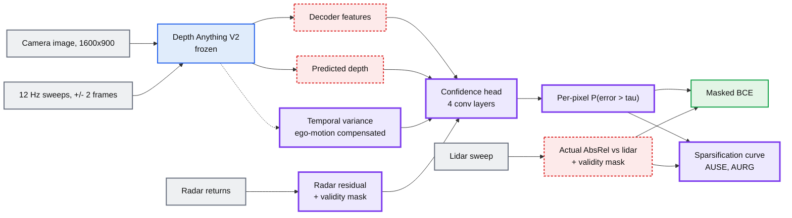
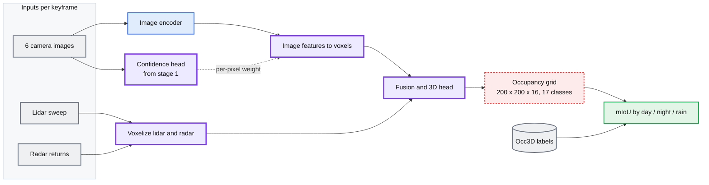

# Route B: Can we predict where Depth Anything is wrong, before we see the error?

> Depth Anything V2 outputs a depth for every pixel and no indication of which pixels to trust. This project trains a small model that reads the depth model's own features and predicts, per pixel, whether that depth is about to be wrong.

The prediction is made from the camera alone plus a few hundred radar points.
The answer key comes from lidar, which the deployed system would not have. So
the model is learning to anticipate an error it cannot measure.

---

## The pipeline

---

## What the confidence head is

A small convolutional network, roughly four layers, single-digit millions of
parameters. It is the only thing whose weights change.

**Input.** One tensor per camera image, channels stacked:

| Channel group | Count | Where it comes from |
|---|---|---|
| Depth Anything decoder features | C (~64-128) | One forward pass of the frozen model |
| Predicted depth | 1 | Same forward pass |
| Temporal depth variance | 1 | Depth on the neighbouring sweeps, reprojected into this frame, per-pixel std |
| Radar residual | 1 | \|predicted depth - radar range\| at pixels a radar point projects into |
| Radar validity | 1 | 1 where a radar point projects within a few pixels, 0 elsewhere |

Shape: `[B, C+4, H, W]`.

**Output.** One channel, same height and width as the image: the probability
that the depth at that pixel is off by more than a threshold. Start with
AbsRel > 0.10 as the threshold and report the choice.

Predicting the error value directly instead of a threshold crossing also works.
The threshold version is easier to calibrate and easier to explain, so start
there.

**Label.** Project the lidar sweep into the image. At each pixel that receives a
lidar return, compute the actual error of the Depth Anything prediction. That
number is the label. No hand annotation anywhere.

**Loss.** Binary cross-entropy, computed only at pixels with a lidar return and
masked everywhere else. Under one percent of pixels carry a label. Confirm the
exact fraction from the sandbox before writing it in the proposal — the depth
view already computes it.

Sparse supervision, dense output. The head is trained on a scatter of labelled
pixels and at inference produces a confidence for every pixel in the image.

---

## Training Path

> Use CARC GPU time

**Pass 1: cache the frozen model's outputs.** Load the Depth Anything checkpoint
and the nuScenes images. Forward pass only, no gradients. Write to disk, per
image: the predicted depth map, the decoder feature map, the temporal variance
map, the radar residual and mask, and the lidar error map. The sandbox already
does the depth part of this at about a minute per scene on an Apple GPU.

**Pass 2: train the head.** Load the cached tensors, not the images. Forward the
head, compute masked BCE against the lidar error labels, backward, step. Depth
Anything is not in the graph, so a step is cheap and batches can be large. This
is hours on one GPU, not days.

**Pass 3: evaluate.** Run the head over held-out scenes. Produce the
sparsification curves and the split tables. No training.

Out of all three: a set of confidence maps, one table, and one plot.

---

## How it is scored

**Sparsification curve.** Sort every labelled pixel by predicted confidence.
Remove the least confident 5%, recompute depth error on what remains, and repeat.
Plot depth error against fraction removed. A useful confidence signal makes the
curve fall fast: throwing out the pixels the head distrusts actually improves the
depth you keep.

Two reference curves go on the same axes. Sorting by the true error gives the
oracle, the best any confidence signal could do. Removing pixels at random gives
the floor. **AUSE** is the area between our curve and the oracle, lower is
better. **AURG** is the gain over random, higher is better. Both come from Poggi
et al., CVPR 2020, which is also where the comparable numbers live.

**Baselines, all cheap:**

- Random removal.
- Raw temporal variance, no learning. This is the direct test of the original
  frame-selector assumption. If the head cannot beat it, that is a result.
- Test-time augmentation: run Depth Anything on the horizontally flipped image
  and use the disagreement as confidence.
- MC dropout, if the checkpoint allows it.
- Oracle.

**Splits.** Every number reported for day, night and rain, using the BEVCar
release of the nuScenes val weather split rather than one we define. Report the
scene count in each split next to the number.

---

## Things to keep in mind

**Lidar labels are missing where they would be most interesting.** Wet asphalt
is specular and returns fewer lidar points. In rain we get fewer labels exactly
in the region where camera depth is most suspect. Report label density per
weather split so this is visible rather than hidden.

**The radar channels are mostly zeros.** Five radars return a few hundred points
per keyframe. Projected into six images, most pixels have no radar and the
validity mask is 0. The head has to learn to use a signal that is present in a
small fraction of the image. Run the ablation with the radar channels removed —
if it makes no difference, say so.

---

## Stage 2, if there is time: feed the confidence into occupancy

The camera branch of an occupancy network lifts image features into voxels, and
that lifting is weighted by depth. The confidence map is a weight for that
lifting: unstable pixels contribute less. This is the version of the
depth-variance idea that has a number attached to it.

One row in the table with the weighting, one without. Occ3D is the ground truth,
so the number is comparable to published work.

This stage trains a full occupancy network and is where the compute risk lives.
Stage 1 stands on its own without it.

---

