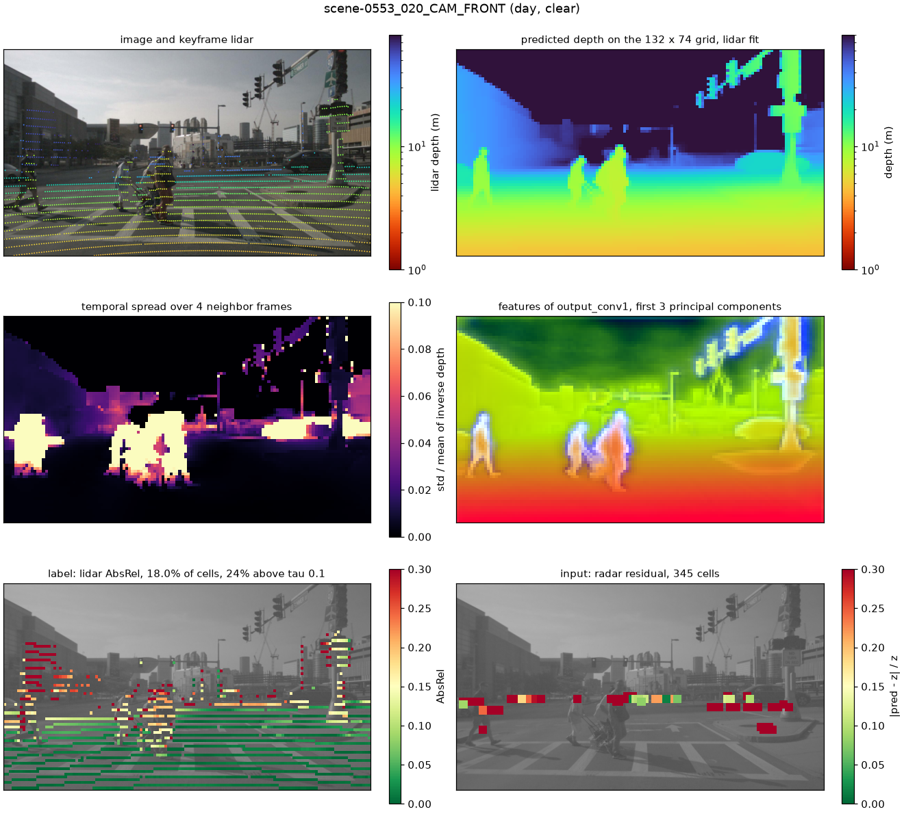

# confhead

## About

Depth Anything V2 gives a depth for every pixel of a camera image, but it does not say which pixels to trust. Our CSCI 566 project trains a small head on top of the frozen model that predicts, per pixel, when that depth is wrong. Lidar supplies the answer key in training. Radar, which a deployed car has, is one of the inputs. See [Form B](../Docs/Prepreposal/Brainstorm/Project%20Scope%20Visual%20(Form%20B).md) and the [pre-proposal](../Docs/Prepreposal/Deliberable/CS566%20-%20Project%20Pre-proposal.pdf).

`confhead` is the Python library for every part of that work. It reads nuScenes, runs the frozen model, builds the cache that the head trains on, and holds the head and its scores.

The confidence head trains on a few features downstream of the Depth Anything prediction:
- DA2 decoder features
- DA2 prediction (depth)
- Temporal depth spread over the neighbor frames
- lidar and radar points (labels and radar inputs)

Changes to the head do not change these inputs, so the library calculates them once and caches them. Training and evaluation then run without a full DA2 forward pass for each step.



One entry of the cache. Each block is one grid cell (here 132 x 74, at `grid.patch_multiple = 2`). The pedestrians move, so their temporal spread is high, and the lidar labels show where the depth is wrong by more than 10%.

## Quickstart

### Prerequisites

- [uv](https://docs.astral.sh/uv/). It installs Python 3.12.
- nuScenes v1.0-mini with its `sweeps/` folder, at `datasets/nuscenes/v1.0-mini` in the repository, or anywhere with `NUSCENES_DATAROOT` set.
- The Depth Anything V2 ViT-B checkpoint, [`depth_anything_v2_vitb.pth`](https://huggingface.co/depth-anything/Depth-Anything-V2-Base/resolve/main/depth_anything_v2_vitb.pth).

### Setup

Run every command from this folder:

```sh
cd confhead
uv sync
export DEPTH_ANYTHING_CHECKPOINT=/path/to/depth_anything_v2_vitb.pth
```

### Use the library

```python
from confhead import Cache, ConfidenceDataset, HeadInputs, NuScenes, load_points

nusc = NuScenes("datasets/nuscenes/v1.0-mini")
item = nusc.items(scenes=["scene-0553"], cameras=["CAM_FRONT"])[0]
lidar = load_points(item.lidar, item.view)   # (N, 5): u, v, z, dt, sweep

train = ConfidenceDataset(Cache("outputs/cache/nuscenes-mini"), tag="train")
sample = train[0]
sample["x"]       # (64 + 4, 148, 264): features, depth, temporal spread, radar residual, radar validity
sample["target"]  # (1, 148, 264): 1 where the AbsRel against lidar is above tau (0.10)
sample["mask"]    # (1, 148, 264): 1 where a lidar label exists

no_radar = ConfidenceDataset(Cache("outputs/cache/nuscenes-mini"), HeadInputs(radar=False), tag="train")
```

`Cache.rows()` and `Cache.entries()` filter by `tag` (train, val), `scene`, `channel`, `condition` (day, night), and `weather` (clear, rain).

### Run the examples

The scripts in [`examples/`](examples/) show the library at work. Each takes `--help`.

List the scenes, and draw the lidar and radar on the six cameras of each scene's first keyframe into `outputs/overlays/`:

```sh
uv run examples/explore_nuscenes.py
```

Measure the lidar and radar pixel density of every camera image into [`results/projection-density.md`](results/projection-density.md):

```sh
uv run examples/projection_density.py
```

See what a cache build will do and how much disk it needs, then build it. A stopped build continues where it stopped. At the end, the script checks every entry and prints statistics:

```sh
uv run examples/build_cache.py --plan
uv run examples/build_cache.py --limit 12
uv run examples/build_cache.py
```

See what a cache folder holds and its size on disk, without opening an entry:

```sh
uv run confhead cache info outputs/cache/nuscenes-mini
```

Draw cache entries as figures like the one above, and read one training batch:

```sh
uv run examples/preview_cache.py scene-0553_020_CAM_FRONT
uv run examples/read_cache.py
```

Train the head on the mini cache with no notebook open, into `outputs/runs/mini/`. `--estimate` trains nothing: it prints the splits, the input statistics, and the time of one epoch. A run folder that holds `last.pt` continues after its last epoch:

```sh
uv run examples/train_head.py --estimate
uv run examples/train_head.py
```

Run the tests. The tests on real data run when the dataset is at its default place, and the build test runs when `DEPTH_ANYTHING_CHECKPOINT` is set:

```sh
uv run pytest
```

### Learn the cache in a notebook

[`notebooks/cache-tutorial.ipynb`](notebooks/cache-tutorial.ipynb) is a tour of a built cache: the index, one entry and its arrays, the figures, the labels, and the training set. [guides/notebook-on-carc.md](guides/notebook-on-carc.md) opens it in JupyterLab on CARC. On your own computer:

```sh
uv sync --group notebook
uv run python -m ipykernel install --user --name confhead --display-name confhead
uv run jupyter lab notebooks/cache-tutorial.ipynb
```

### Train the head in a notebook

[`notebooks/train-head.ipynb`](notebooks/train-head.ipynb) trains the confidence head on a built cache, and keeps the checkpoint with the lowest loss on a dev split of the train scenes. It runs the steps of `Training` from `confhead.train` one by one, and `examples/train_head.py` runs the same `Training` in one call. Each run writes its settings and checkpoints to `outputs/runs/`, or to `/scratch1/$USER/confhead-runs/` on CARC. [`notebooks/eval-template.ipynb`](notebooks/eval-template.ipynb) loads a checkpoint with `load_head` and predicts `p_error` for val images: a starting point for the eval runner. [guides/notebook-on-carc.md](guides/notebook-on-carc.md) opens both on CARC. On your own computer, after the two commands above:

```sh
uv run jupyter lab notebooks/train-head.ipynb
```

A checkpoint holds the head and the `HeadInputs` of its training, so one call gives back what a prediction needs:

```python
import torch
from confhead import Cache, ConfidenceDataset, load_head

head, inputs, info = load_head("outputs/runs/<run>/best.pt")
x = ConfidenceDataset(Cache("outputs/cache/nuscenes-mini"), inputs, tag="val")[0]["x"]
p_error = torch.sigmoid(head(x[None]))  # (1, 1, h, w): the chance that the depth in each cell is wrong
```

### Cache settings

[`configs/nuscenes-mini.toml`](configs/nuscenes-mini.toml) holds every setting, and [`cache/config.py`](src/confhead/cache/config.py) says what each one does. `--set section.key=value` changes one setting for one run.

The settings that change the content of an entry make a fingerprint. A build into a cache with another fingerprint stops and names the settings that differ. Use another `output.root`, or `--overwrite` to build every entry again.

| Setting | Default | Effect |
|---|---|---|
| `model.tap` | `output_conv1` | The decoder layer to keep: `output_conv1` (64 channels), `refinenet1` or `refinenet2` (128) |
| `grid.patch_multiple` | `4` | Grid of the dense maps: the 66 x 37 patch grid times this. 4 gives 264 x 148 and about 13 GB for mini; 2 gives 132 x 74 and 3.4 GB. |
| `temporal.offsets` | `[-2, -1, 1, 2]` | The 12 Hz camera frames around the keyframe |
| `temporal.align` | `lidar` | The points that give the keyframe its metric scale, for moving pixels between frames |
| `points.radar_sweeps` | `5` | Radar sweeps per sensor, the keyframe sweep and the ones before it |
| `run.precision` | `fp32` | `fp16` or `bf16` is faster on CUDA, and changes the fingerprint |

### On CARC

[guides/cache-building-on-carc.md](guides/cache-building-on-carc.md) builds the cache for the full nuScenes v1.0-trainval with [`configs/nuscenes-trainval.toml`](configs/nuscenes-trainval.toml). One command submits a GPU job array that builds the shards, and a CPU job that checks the cache after the shards end:

```sh
examples/carc-submit.sh configs/nuscenes-trainval.toml 16
```

[guides/training-on-carc.md](guides/training-on-carc.md) trains the head on that cache as a batch job on one GPU, with [`configs/train-trainval.toml`](configs/train-trainval.toml). A job that stops at its time limit continues when you submit it again:

```sh
sbatch examples/carc-train.sbatch configs/train-trainval.toml
```

[guides/cache-backup-on-huggingface.md](guides/cache-backup-on-huggingface.md) backs up a built cache to a Hugging Face dataset repository as compressed shards, and restores it:

```sh
sbatch examples/carc-upload.sbatch /scratch1/$USER/confhead-cache/nuscenes-trainval
uv run confhead cache download nuscenes-trainval /scratch1/$USER/confhead-cache/nuscenes-trainval
```

## API

| Module | What it holds |
|---|---|
| [`nuscenes`](src/confhead/nuscenes.py) | `NuScenes`: the tables, the scenes with their condition and weather, and the camera `Item`s; the lidar and radar file readers |
| [`items`](src/confhead/items.py) | `Item`, `View`, `PointFile`: one camera image with its neighbors and sweeps; `load_points` |
| [`geometry`](src/confhead/geometry.py) | Frames, projection, pixel grids, sampling, rasterizing, and the scale-and-shift `Fit` |
| [`depth`](src/confhead/depth.py) | `FrozenDepthAnything`: disparity and one decoder feature map; `preprocess` |
| [`cache`](src/confhead/cache/) | `CacheConfig`, `load_config`, `build`, `plan`, `verify`, `info`, and the `Cache` reader; `backup`: `upload` and `download` on Hugging Face |
| [`cli`](src/confhead/cli.py) | The `confhead` command: `cache info`, `cache upload`, `cache download` |
| [`labels`](src/confhead/labels.py) | `LabelConfig`, `lidar_labels`: where the depth is wrong against lidar |
| [`dataset`](src/confhead/dataset.py) | `ConfidenceDataset`, `HeadInputs`, `RadarConfig`: the head inputs and labels as a PyTorch `Dataset` |
| [`head`](src/confhead/head.py) | `ConfidenceHead`, `masked_bce`, `save_head`, `load_head`: the head over the inputs, its loss on the labeled cells, and its checkpoints |
| [`train`](src/confhead/train.py) | `TrainConfig`, `load_train_config`, `Training`, `dev_scenes`: the training settings, the dev split by scene, and one training run with its run folder |
| [`plot`](src/confhead/plot.py) | `draw_points`, `draw_map`, `entry_figure`: matplotlib figures of items and cache entries |

## Conventions

The rules that the code follows, and why, are in [design.md](design.md).

## Layout

- `src/confhead/`: the library, and the `confhead` command in `cli.py`. `depth_anything_v2/` is the vendored model.
- `examples/`: scripts that use the library, and the CARC job scripts.
- `guides/`: step-by-step guides.
- `notebooks/`: the tour of a built cache, the training of the head on it, and a template that loads the head and predicts.
- `configs/`: cache settings, training settings, and the Hugging Face repository of the backup.
- `results/`: the small summaries that the team reads.
- `docs/`: the figure of this README.
- `outputs/`: caches, figures, tables, and training runs that the examples and notebooks write. Not in git.

## References

- [Depth Anything V2](https://github.com/DepthAnything/Depth-Anything-V2) (Apache 2.0). `src/confhead/depth_anything_v2/` is a copy; the header of `dpt.py` says what changed.
- [nuScenes](https://www.nuscenes.org/nuscenes). The loader reads the JSON tables with numpy and does not need the nuscenes-devkit.
