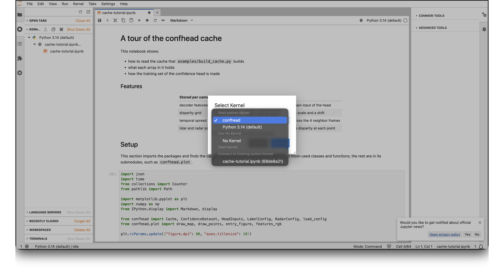

# Open the Notebooks on CARC

Three notebooks run on the cache from [cache-building-on-carc.md](cache-building-on-carc.md). [`notebooks/cache-tutorial.ipynb`](../notebooks/cache-tutorial.ipynb) is a tour of the cache and the API that reads it. [`notebooks/train-head.ipynb`](../notebooks/train-head.ipynb) trains the confidence head. [`notebooks/eval-template.ipynb`](../notebooks/eval-template.ipynb) loads a trained head and predicts with it, as a template for the eval team. This guide opens them in JupyterLab on CARC. The training needs a GPU (step 4), and the other two need none. Without the JupyterLab part, the same steps open them on your own computer.

## 1. Register the Kernel

JupyterLab runs code in a kernel. The kernel must be the Python of the `confhead` environment, so that `import confhead` works. Register it once, from a CARC login node:

```sh
cd ~/Vision-Project-CSCI-566/confhead
git pull
uv sync --group notebook
uv run python -m ipykernel install --user --name confhead --display-name confhead
```

`uv sync --group notebook` adds JupyterLab and the kernel package to the environment. The last command writes `~/.local/share/jupyter/kernels/confhead/kernel.json`, which points at `.venv/bin/python`. JupyterLab lists it as **confhead**. Run the two commands again after you move or rebuild `.venv`.

To check:

```sh
uv run jupyter kernelspec list
```

## 2. Start JupyterLab

Go to [ondemand.carc.usc.edu](https://ondemand.carc.usc.edu), open **Interactive Apps**, and choose **JupyterLab**. Fill in the form:

| Field | Value |
|---|---|
| Account | your project account, the one in `SBATCH_ACCOUNT` |
| Partition | `main`; the tutorial and the eval template need no GPU |
| CPUs | 4 |
| Memory | 16 GB. The trainval index takes a few hundred MB; section 11 of the tutorial loads the nuScenes tables, which take several GB. |
| Time | 2 hours |

Click **Launch**. When the session starts, click **Connect to Jupyter**.

## 3. Open the Notebook

In the file browser on the left, go to `Vision-Project-CSCI-566/confhead/notebooks` and open `cache-tutorial.ipynb`. If JupyterLab asks for a kernel, choose **confhead**. The kernel name is also at the top right of the notebook; click it to change it.



Run the cells from the top. The *Setup* section finds the cache:

- With no change, it opens your own cache, `/scratch1/$USER/confhead-cache/nuscenes-trainval`.
- To open a cache that a teammate built, set `CACHE_ROOT` in the second code cell to their path, for example `"/scratch1/<user>/confhead-cache/nuscenes-trainval"`. The images come from their dataset, which the cache remembers.

## 4. Train the Head on a GPU

`train-head.ipynb` needs a GPU session. Start JupyterLab as in step 2, with these fields changed:

| Field | Value |
|---|---|
| Partition | `gpu` |
| GPU Type | any; the head is small |
| Number of GPUs | 1 |
| Number of CPUs | 8. The notebook reads the cache with one loader process per CPU, less one. |
| Memory (GB) | 32 |
| Number of hours | the time that section 5 of the notebook estimates, plus an hour |

Open `train-head.ipynb` with the **confhead** kernel and run the cells from the top. The device that section 1 prints must be `cuda`. Section 5 measures how fast the session reads the cache, and estimates the time of the run. If one epoch takes more than 2 hours, set `cfg.train.samples_per_epoch` as the notebook says.

Each run writes its files to `/scratch1/$USER/confhead-runs/<run>`, and the notebook prints the folder. If the session ends before the training does, start a new session. Set `cfg.output.name` in the settings cell to the name of the run folder, and run the cells from the top again: the training continues after the last epoch that finished.

For a run longer than a session, [training-on-carc.md](training-on-carc.md) runs the same training as a batch job, with no session to keep open.

## On Your Own Computer

Steps 1 and 3 are the same. Instead of step 2:

```sh
uv run jupyter lab notebooks/cache-tutorial.ipynb
```

With no trainval cache on the machine, each notebook opens the mini cache under `outputs/cache/`, which `examples/build_cache.py` builds from nuScenes v1.0-mini. Open `train-head.ipynb` from JupyterLab the same way. On the mini cache, a Mac with an Apple GPU runs the whole training notebook in about a minute.

## If Something Goes Wrong

| Problem | What to do |
|---|---|
| **confhead** is not in the kernel list | Do step 1 again. Then refresh the JupyterLab page: the list loads when the page opens. |
| `ModuleNotFoundError`, for example `No module named 'matplotlib'` or `'confhead'` | The notebook runs on another kernel, such as CARC's default Python. Choose **confhead** at the top right. |
| `FileNotFoundError: no cache found` | Set `CACHE_ROOT` to the cache path. The path must hold `index.json`; if it does not, the check job of the build has not run yet. |
| `entry.image()` cannot find the image | The dataset is not where the cache was built from. Set `DATAROOT` in the second code cell. |
| The kernel dies in section 11 of the tutorial | The session has too little memory for the trainval tables. Start a JupyterLab session with more, or skip the section. |
| `train-head.ipynb` prints `device cpu` | The session has no GPU. Start one on the `gpu` partition, with 1 in **Number of GPUs**. |
